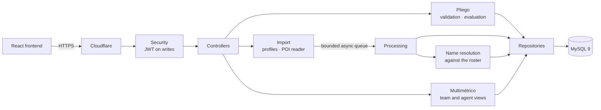

# Multimétrico API

Backend for the **multimétrico**: the dashboard where every agent of a customer-service operation sees how they're doing on each performance metric — average handling time, NPS, first-contact resolution, sales activity, cancellations — and how much each one pays them.

**Live demo:** [multimetrico.lautaromoreyra.dev](https://multimetrico.lautaromoreyra.dev) · Frontend: [multimetrico-frontend](https://github.com/lautaromoreyraa/multimetrico-frontend)


## The problem

Each metric is turned into a payout by running it through a table of ranges. The document that defines those ranges — the **pliego** — changes every month, and in practice it lives in a 50-sheet spreadsheet with three real problems:

- **Last month's rules are overwritten.** There's only one sheet for the current month, so a past month can't be recalculated: applying today's ranges to March's data gives a different number.
- **Ranges are written wrong and nobody notices.** They're typed with both ends inclusive and already rounded (`79.5%–80.0%`, then `80.1%–81.1%`), which leaves gaps — 80.04% falls in no range — and allows overlaps. The spreadsheet silently takes the first match.
- **Nobody can tell why a number changed.** With targets moving every month, an agent can have the same NPS in July and August and be paid differently. The spreadsheet shows the result, not the rule that produced it.

## How it solves it

- **The pliego is a versioned entity tied to its period.** Recalculating March always uses March's rules, which makes it possible to separate how much the agent moved from how much the bar moved.
- **Ranges are half-open intervals `[from, to)`.** Each range ends where the next one begins, so gaps and overlaps are impossible by construction; open ends (`null`) keep a perfect 100% inside the scale. Values are `BigDecimal` compared with `compareTo` and stored as `DECIMAL(18,6)`, because values land exactly on the edges — which is where floating point fails.
- **A pliego is validated on upload and rejected as a whole**, with the *complete* list of problems (overlaps, gaps, scales that don't cover the extremes, weights that don't match the top range, duplicated metrics), so it can be fixed in one pass.
- **Every result travels with its range.** Not *"your NPS paid 2.0%"* but *"your NPS of 55.4% fell in `[53.2%, 57.3%)`, which pays 2.0%"* — a number that can be argued with.

```
POST /api/pliegos   (a pliego with two overlapping ranges)

422  ranges [-∞, 681) and [680, +∞) overlap between 680 and 681:
     a value there falls in both
```

## Matching names to people

The metric files **carry no employee ID**: they carry a name written by another system, truncated to a fixed length and sometimes with broken encoding. When a name doesn't match, the person silently disappears from the dashboard.

The **roster** (*padrón*) gives identity to those rows — and knows each agent's team lead, so filtering by team is done by the system instead of by someone opening every file each week. A name is resolved through four strategies, safest first: employee ID, exact normalized name, an alias already confirmed by a person, and a unique prefix.

**It never guesses.** A similarity measure exists, but only to *suggest* candidates: in a calculation that ends in how much someone gets paid, resolving by similarity means attributing one person's metrics to another without leaving a trace. Ties stay pending with every candidate listed, and once a person confirms a match the system **learns the alias** and never asks again. The invariant: `resolved + pending` always equals the rows that came in — nothing is dropped silently.

## Tech stack

| Layer | Choice |
|---|---|
| Language / framework | Java 21, Spring Boot 3.5 (Web, Data JPA, Security, Validation, Actuator) |
| Database | MySQL 9, schema owned by Flyway |
| File import | Apache POI with configurable import profiles, processed asynchronously on a bounded queue |
| Auth | JWT — reading is public, every write requires an account |
| Tests | JUnit 5, Spring Boot Test, H2 in MySQL mode running the same Flyway migrations |
| Runtime | Multi-stage Docker image, non-root user, layered jar |
| Hosting | Railway behind Cloudflare |

## Architecture



**Import flow:** an admin uploads the weekly file → its **import profile** says which sheet and which columns hold each value (columns are found by header text, not by Excel letter, so a moved column still works) → rows are read, resolved against the roster and stored as **new measurements, never updates**, so it's always possible to reconstruct why a number changed within a month → the import report lists what was resolved and what is pending, and if the file didn't match its profile, exactly what was expected and what was found.

## Project structure

```
src/main/java/com/lautaro/multimetrico
├── config/                 security, JWT, auditing, async import executor, typed properties
├── controller/             HTTP only
├── domain/                 JPA entities (Pliego, Escala, Banda, Medicion, Importacion, …)
├── dto/<area>/             request and response records per area
├── enumeration/            metrics, range conditions, import states, …
├── exception/              custom exceptions and the global error handler
├── mapper/ + mapper/impl/  hand-written entity ⇄ DTO translation
├── repository/             Spring Data interfaces
├── service/<area>/         pliego, validacion, importacion, planilla, procesamiento,
│                           resolucion, padron, medicion, multimetrico, incentivo, seguridad
└── util/                   stateless helpers (decimals, periods)
src/main/resources/db/migration   Flyway migrations
scripts/                          sample-data loader
```

Domain names are in Spanish because they are the business's own terms (*pliego*, *escala*, *banda*, *padrón*); technical suffixes stay in English. Mappers are written by hand because translating between entities and DTOs involves decisions — what gets exposed and what doesn't — that an annotation can't document.

## API overview

| Area | Endpoints |
|---|---|
| Auth | `POST /api/auth/login`, `GET /api/auth/yo` |
| Pliego | `POST /api/pliegos/revision` (dry run), `GET POST /api/pliegos`, `GET /api/pliegos/{period}`, `POST /api/pliegos/{period}/evaluacion` |
| Roster | `GET /api/padrones/{period}`, `GET …/lideres`, `POST PUT DELETE …/asesores`, `POST …/resolucion`, `POST …/alias` |
| Import | `POST /api/importaciones`, `GET /api/importaciones/{id}`, `POST …/{id}/pendientes/{row}` |
| Import profiles | `GET POST /api/perfiles`, `POST /api/perfiles/inspeccion` |
| Measurements | `POST /api/mediciones`, `GET /api/mediciones/{period}` |
| Dashboard | `GET /api/multimetrico/{period}`, `GET /api/multimetrico/{period}/asesores/{id}` |
| Incentives | `GET POST /api/incentivos/{period}` |

## Getting started

**Prerequisites:** Java 21, Node 20+ (for the sample-data script) and Docker or Podman.

```bash
docker compose up -d               # MySQL on port 3307
cp src/main/resources/application-local.properties.example \
   src/main/resources/application-local.properties   # set the JWT secret
./mvnw spring-boot:run             # API on port 8082
node scripts/datos-de-ejemplo.mjs  # sample data from January to the current month
```

The sample data covers fifteen agents, two team leads, the five metrics, and a pliego and roster per month — with four weekly loads per metric and a few agents missing files, so every rule of the dashboard has something to show. Running it twice is harmless.

### Tests

```bash
./mvnw test     # no database needed: H2 in MySQL mode with the same migrations
```

## Deployment

The `Dockerfile` builds in two stages, splits the jar into Spring Boot layers and runs as an unprivileged user with an explicit JVM memory ceiling. Railway only promotes a deployment once `/actuator/health` reports `UP`; service settings live in `.railway/railway.ts`.

## About the data

The project is modeled on a real process but **contains no data from any operation**. The thresholds in the tests are invented — a company's targets are internal and don't belong in a repository — and the system is built and tested with synthetic data only.
